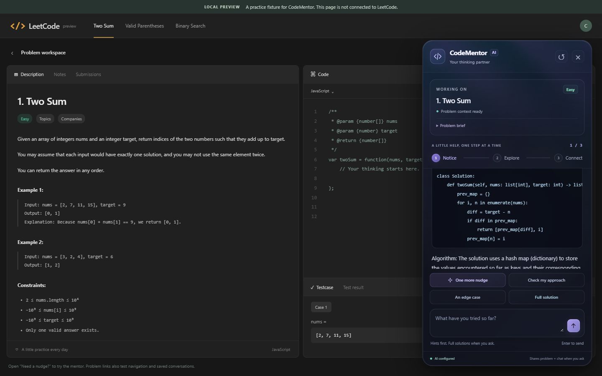

# CodeMentor AI

A Chrome extension that sits beside a LeetCode problem and helps you find your next step. Open **Need a nudge?** for a small hint, approach feedback, or a full solution with code and an explanation when you ask for one.

For cloning, saving future updates, and restoring backups, see the [development guide](docs/development.md).



## Run the first version

You need Chrome, Python 3.11 or newer, and Node 20+. The extension keeps its plain JavaScript panel and service worker. Its optional React/WebGL visual layer is bundled locally; generated assets are included, and should be rebuilt when changing `frontend/`.

From the project folder in PowerShell:

```powershell
npm.cmd ci
npm.cmd run build
# Skip creating the environment if backend\venv already exists.
python -m venv backend\venv
backend\venv\Scripts\python.exe -m pip install -r backend\requirements.txt
backend\venv\Scripts\python.exe -m uvicorn backend.main:app --host 127.0.0.1 --port 8000
```

Leave the server running. Open [the health endpoint](http://127.0.0.1:8000/health) to confirm it returns `"status":"ok"`. Without a provider key it reports `"mode":"demo"`; with a key it reports `"mode":"ai"` and the configured provider and model. This endpoint checks configuration, not provider connectivity. API documentation is available at [localhost:8000/docs](http://127.0.0.1:8000/docs).

1. Open `chrome://extensions` in Chrome and enable **Developer mode**.
2. Choose **Load unpacked** and select this project's `extension` folder.
3. Open [Two Sum](https://leetcode.com/problems/two-sum/) and refresh the tab if it was already open.
4. Click **Need a nudge?**, then **A small hint**. The extension toolbar popup can also open the mentor and check the backend connection.

After editing extension files, click **Reload** on its Chrome extensions card and refresh the LeetCode tab.

## What works

- An on-demand panel that stays out of the way until opened, with keyboard support and styles isolated from the host page.
- A dark glass panel and popup with mouse-following highlights, an expandable problem brief, and a lazy ambient shader. Reduced motion and unavailable WebGL use a static background. See [visual integration notes](docs/visual-upgrade.md).
- Three explicit hint levels: **Notice → Explore → Connect**. A successful hint advances one level; ordinary conversation and approach reviews do not. After level three, you can keep discussing your reasoning.
- **Full solution** returns code, an explanation, and complexity information. You can also type an explicit request such as “Give me the full Python solution.” Solutions do not advance the hint level. AI solutions default to Python unless you request another language.
- Approach review for text you share, and prompts to think about edge cases. To review an approach, type it and click **Check my approach**.
- Separate conversations for each problem, including navigation within LeetCode. The latest 30 problems and 40 messages per problem are saved in the extension's local storage. The reset arrow clears the current conversation and hint progression.
- Connection status, loading states, timeouts, and retry. A failed reply preserves the draft and does not spend a hint level.
- **Demo mode**, which works without a key and makes no external AI calls. Two Sum, Valid Parentheses, and Binary Search have curated progressive hints and Python solutions. Other problems receive general thinking prompts and need AI configuration for a full solution. Demo replies do not assess the correctness of arbitrary code.

## Enable AI mentoring

Create `backend/.env` from `backend/.env.example` if it does not already exist:

```powershell
# Do this only if you have not already created backend/.env.
Copy-Item backend\.env.example backend\.env
```

Set these values in `backend/.env`, using your own Gemini API key:

```dotenv
AI_PROVIDER=gemini
GEMINI_API_KEY=your_gemini_api_key
GEMINI_MODEL=gemini-3.1-flash-lite
```

`GOOGLE_API_KEY` is also accepted when `GEMINI_API_KEY` is empty. To use the existing OpenAI integration, set `AI_PROVIDER=openai`, `OPENAI_API_KEY`, and `OPENAI_MODEL` instead. Its default model is `gpt-6-astra`. The OpenAI configuration sends `reasoning.effort: low`, so select a compatible Responses API model. With `AI_PROVIDER=auto` (the default), a Gemini key takes priority over an OpenAI key. An explicitly selected provider with no key uses demo mode.

Restart the backend after changing the configuration. **AI configured** confirms configuration, not a successful provider call. Ask for a hint or solution to verify the provider connection. Invalid keys, billing limits, and provider errors appear explicitly when you ask. Your API account is billed for AI requests. Never add the key to extension code or commit `.env`. Gemini credentials are sent in a request header to Google's API from the backend.

If Gemini reports that a model is not available, set `GEMINI_MODEL` to a model available to your API project and restart the backend. The current default is `gemini-3.1-flash-lite`.

Hint, review, and edge-case requests use instructions to give one conceptual nudge at a time. Their response guard catches obvious code and long recipes. Gemini solutions return structured code lines and an explanation; the backend preserves indentation and builds the code block. Python solutions receive a syntax check without being executed. Asking for a hint after a solution uses the original problem and current hint level, omitting the earlier code from the provider context. The problem and conversation are treated as untrusted context. These measures reduce unwanted spoilers; generated responses may still be incorrect or reveal more than intended.

## Try the local preview

With the backend running, open another terminal:

```powershell
backend\venv\Scripts\python.exe tools\preview.py
```

Open [the preview](http://127.0.0.1:4173/problems/two-sum/). It runs the same panel JavaScript and CSS against a local practice page, with a mock Chrome API and a proxy to the real backend. The navigation links exercise problem switching and history. This is a development fixture, not live LeetCode or an installed extension. Its local history is separate from the extension's history. Stop either server with Ctrl+C in its terminal.

## Data flow and scope

```text
LeetCode description + your message + recent conversation
  → extension content script
  → Chrome service worker
  → local FastAPI server at 127.0.0.1:8000
  → curated demo OR Gemini API OR OpenAI Responses API
```

The page title and description are read locally. Only asking for help sends that context, your message, and at most 12 prior messages (up to 4,000 characters each) to the backend. Health checks send no problem data. The extension does not read the code editor, submit code, monitor keystrokes, or open LeetCode's solutions. You can paste relevant code into the chat yourself. Replies render as text, with fenced code displayed in code blocks; provider content is never inserted as HTML. OpenAI requests use `store: false`. Each provider's data-use and retention policies apply to its requests. The backend does not persist conversations.

The extension runs only on `https://leetcode.com/`, uses `storage` and `activeTab`, and can contact only the loopback backend. Keep the server bound to `127.0.0.1`; this version is a personal development tool and has no production authentication, user accounts, or hosted service. Preview assets are explicitly allowlisted; the preview server does not serve `.env` or arbitrary project files.

Problem extraction depends on LeetCode's DOM. If context is missing, open the **Description** tab or paste the relevant requirement. LeetCode layout changes may require selector updates in `extension/content.js`. The local fixture verifies the panel flow; live Chrome installation and current LeetCode selectors still need a smoke test in your browser.

## Checks

```powershell
npm.cmd run build
npm.cmd run check
npm.cmd test
backend\venv\Scripts\python.exe -m unittest discover -s backend -v
```

JavaScript tests cover the service-worker bridge, sender restrictions, failed requests, history bounds, code-block handling, and hint progression. Backend tests cover demo coaching and solutions, validation, solution intent, provider selection, and mocked Gemini/OpenAI success and failure. These automated tests never call the live AI provider.

Verified on October 28, 2026: the visual build, syntax checks, all 38 JavaScript tests, and 34 backend tests passed. The local preview returned a live Gemini hint and a Python solution; desktop/narrow layouts, problem switching, history restoration, and visual cleanup were checked. See [the full visual upgrade report](docs/visual-upgrade.md).

Live Gemini verification on October 24, 2026, using `gemini-3.1-flash-lite`: full Python solution with an explanation, followed by a small hint on the original problem. Browser checks against the local preview confirmed indented code blocks with horizontal scrolling, draft preservation, unchanged hint progress for solutions, the hint cap, and conversation restoration after refresh. This does not verify the installed Chrome extension against live LeetCode.

## Project layout

```text
extension/manifest.json   Chrome Manifest V3 configuration
extension/content.js     On-page panel and conversation lifecycle
extension/core.js        Request construction and session normalization
extension/styles.css     Isolated panel styles
extension/background.js  Validated requests to the local backend
extension/popup.*         Toolbar popup and connection status
extension/visual-loader.js Lazy visual lifecycle and accessibility fallback
extension/assets/         Bundled local visual module and licenses
frontend/                 ShaderGradient, Fiber, and isolated Liquid Glass source
extension/tests/         Dependency-free Node tests
backend/main.py          FastAPI API, coaching policies, and AI integration
backend/test_main.py     Network-free backend tests
tools/preview.*          Local browser preview and fixed backend proxy
tools/build.mjs          esbuild visual bundle and dependency/license validation
```

Useful next increments are richer practice feedback, explicitly opted-in code context, and testing across more LeetCode layouts.
